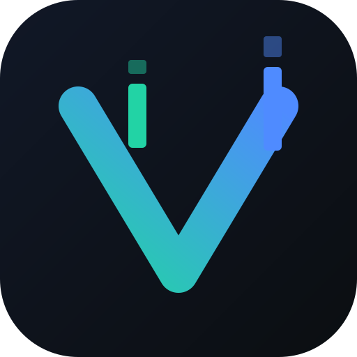

# OmniTrading

[](LICENSE)
[](https://nodejs.org)
[](https://www.typescriptlang.org)
[](CONTRIBUTING.md)

> **fast, local, private, fully customizable trading platform: bring your own broker**

OmniTrading is an open-source, broker-neutral trading desktop application. It combines high-performance charting powered by [Vela™](https://luxalgo.com/vela) ([velacharts.dev](https://velacharts.dev)) with universal broker connectivity, multi-account management, instant paper trading, and user-configurable safety guardrails.

---

<!-- TODO for repository owner: Add your hero animation GIF or application screenshot below -->
<div align="center">
  
  <p><em>[TODO: Insert hero GIF demo showing multi-chart grid and execution here]</em></p>
</div>

---

## Key Features

- **⚡ Instant Built-in Paper Trading**: Trade immediately with zero setup, zero API keys, and simulated cash balance.
- **🔌 100% Broker-Neutral**: Bring your own credentials for any supported broker. No broker is favored, defaulted, or locked in.
- **🛡️ Server-Enforced Safety Guardrails**:
  - Global Topbar **Kill Switch** that blocks all order execution instantly.
  - Conservative **max order volume limits** enforced server-side.
  - **Live accounts start disabled** by default, requiring explicit risk acknowledgment before trading.
  - Order confirmation prompts on by default.
  - Local, sanitized order audit trail.
- **📊 Professional Charting**:
  - Multi-chart cell grids (1, 2, 3, 4 splits, sync crosshairs, color linking).
  - Floating Quick Trade widget with live pip distance calculation.
  - Customizable color palettes (Dracula, Tokyo Night, Catppuccin, Nord, Obsidian Monochrome).
  - 32 royalty-free audio alerts (nature, voices, bell, chimes).
  - Bar Replay with step controls and variable speeds.
- **🔒 Local & Private**: All API keys, secrets, and layouts are stored exclusively on your device. Zero telemetry.
- **🧩 Pluggable Indicators**: Drop custom Pine Script or TypeScript indicators into `custom-indicators/` without exposing your private strategies to Git.

---

## Supported Brokers

OmniTrading is broker-neutral. Active broker adapters:

| Broker / Platform | Adapter ID | Status | Auth Type | Environment | Official Documentation |
| :--- | :--- | :--- | :--- | :--- | :--- |
| **Paper Trading (Local Simulation)** | `paper` | **Stable (Default)** | None (Built-in) | Paper | *Built into OmniTrading* |
| **cTrader** | `ctrader` | **Beta** | OAuth / Open API | Demo & Live | [cTrader Open API Docs](https://openapi.ctrader.com/apps) |

### Wanted Adapters — Contributions Welcome

OmniTrading is actively seeking community-maintained adapters for:
- **Alpaca Markets** (US Stocks & Crypto) — see [`examples/adapters/alpaca/`](examples/adapters/alpaca/)
- **Binance** (Spot & Futures) — see [`examples/adapters/binance/`](examples/adapters/binance/)
- **Interactive Brokers** (TWS / Client Portal Web API)
- **OANDA** (v20 REST API)
- **MetaTrader 4 / 5** (Bridge / Gateway)

To build or contribute an adapter, see [Adding a Broker Adapter](#adding-a-broker-adapter) and [CONTRIBUTING.md](CONTRIBUTING.md).

---

## Try It in 30 Seconds (Paper Trading)

No broker accounts or API credentials are required to get started. On a clean clone, pure Node.js builds and starts the application across Windows, macOS, and Linux:

```bash
git clone https://github.com/777Business/OmniTrading.git
cd OmniTrading
npm install
npm start
```

Open your browser at `http://127.0.0.1:8787` and trade immediately with simulated paper execution!

---

## Quickstart & Installation

### Prerequisites
- [Node.js](https://nodejs.org) (v18.0.0 or higher)
- npm (v9.0.0 or higher)

### Windows (Command Prompt / PowerShell)
```cmd
git clone https://github.com/777Business/OmniTrading.git
cd OmniTrading
npm install
npm start
```

### macOS (Terminal)
```bash
git clone https://github.com/777Business/OmniTrading.git
cd OmniTrading
npm install
npm start
```

### Linux (Terminal)
```bash
git clone https://github.com/777Business/OmniTrading.git
cd OmniTrading
npm install
npm start
```
*(Optional: Linux/macOS users can also run `./launch.sh` as an optional desktop helper).*

### Docker
```bash
# Build and run with Docker Compose
docker compose up -d
```
> **Security Requirement**: When binding to non-localhost (`0.0.0.0`), you **must** configure `OMNI_AUTH_TOKEN` in your environment. OmniTrading will refuse to start on external networks without an authentication token.
>
> **Accessing Protected Instances**: When connecting to a Docker or remote instance, open `http://<ip>:8787` in your browser. Enter your `OMNI_AUTH_TOKEN` in the authentication form to receive an `HttpOnly`, `SameSite=Strict` session cookie. API clients may also supply `Authorization: Bearer <token>`. Tokens are never transmitted in URLs.

---

## Connecting Your Broker Account

1. Click the **Account Chip** in the topbar (labeled `Paper Local`).
2. Select your broker from the adapter list.
3. Follow the instructions to authorize your account:
   - For **cTrader**: Register a free Open API app at [openapi.ctrader.com/apps](https://openapi.ctrader.com/apps) with redirect URI `http://127.0.0.1:8787/api/auth/callback`. Enter your Client ID and Client Secret, then click Continue with cTrader.
4. Credentials are saved in a local plaintext file (`~/.config/omni-trading/auth.json`) protected by strict filesystem permissions (`0600`, readable only by your operating system user account). Credentials are not encrypted at rest and are never transmitted to external servers.
5. You can connect multiple accounts across multiple brokers and switch between them at any time.

---

## Safety Guardrails

OmniTrading includes the following configurable controls:

1. **Topbar Kill Switch**: A single click on the topbar shield activates the kill switch, which rejects any outgoing order before it reaches the broker.
2. **Server-Side Order Validation**: Order size limits (default max 20 lots) and parameter bounds are validated on the local server.
3. **Live Account Safeguards**: Connecting a live account starts in **Trading Disabled** mode. You must manually check the risk acknowledgment in account settings to activate live execution.
4. **Order Confirmation Dialog**: Enabled by default with estimated price, lot size, and pip distance calculations.

---

## Adding Custom Indicators

OmniTrading keeps your trading strategies private:

1. Drop your custom `.pine` scripts or TypeScript plugins into the `custom-indicators/` directory in the project root.
2. The folder is gitignored so your personal code will never be published to Git.
3. Open the indicator picker on any chart to load your custom indicators immediately.
4. Check `indicators/example_momentum_rsi.pine` for an MIT-licensed reference implementation.

---

## Optional Pine Script™ Add-on

To ensure OmniTrading remains 100% MIT-licensed and free of copyleft dependencies, the Pine Script execution engine (`@luxalgo/vela-pinets`, licensed under AGPL-3.0) is **not bundled** into OmniTrading. The add-on is AGPL-3.0. If you redistribute a build that includes it, AGPL-3.0 terms apply to that build.

The built-in Pine Code Editor remains available for writing, formatting, and managing `.pine` scripts. If you choose to execute Pine Script indicators locally in your browser, you can install the optional execution engine yourself:

```bash
# Install the optional Pine execution engine locally (saved outside Git)
npm run add:pine
```

---

## Adding a Broker Adapter

OmniTrading uses an extensible plugin architecture:

1. Copy `src/brokers/template/customBrokerAdapter.ts` to `src/brokers/adapters/<broker-id>/adapter.ts`.
2. Implement the `BrokerAdapter` interface (credentials schema, order placement, symbol specs).
3. Register the adapter in `src/brokers/registry.ts`.
4. The UI automatically generates the login form and account management controls.
5. See [src/brokers/template/README.md](src/brokers/template/README.md) for complete details.

---

## Trading Risk Disclaimer

> **IMPORTANT NOTICE: PLEASE READ BEFORE USING THIS SOFTWARE**

- **High Risk**: Trading foreign exchange, cryptocurrencies, stocks, commodities, and derivatives on margin carries a high level of risk and may not be suitable for all investors. The high degree of leverage can work against you as well as for you.
- **No Financial Advice**: OmniTrading and its contributors do not provide financial, investment, legal, or tax advice. The software is provided purely as an analytical and manual trade-routing tool.
- **"AS IS" Warranty**: OmniTrading is licensed under the MIT License and provided "AS IS", without warranty of any kind. You are solely responsible for all trading decisions, order executions, and credential security.
- **Test Before Trading**: Always test adapters and strategies thoroughly in Paper Trading or Sandbox environments before trading with real capital.

---

## Legal & Attribution Notices

- **Charting Engine**: Charts powered by **Vela™** ([https://luxalgo.com/vela](https://luxalgo.com/vela) / [https://velacharts.dev](https://velacharts.dev)), developed by LuxAlgo under the Apache License, Version 2.0.
- **Independent Project**: OmniTrading is an independent open-source project and is **not affiliated with, sponsored by, or endorsed by LuxAlgo, Spotware/cTrader, Binance, Alpaca, or TradingView**.
- All trademarks and brand names are the property of their respective owners.
- See [NOTICE](NOTICE) and [THIRD_PARTY_NOTICES](THIRD_PARTY_NOTICES) for full third-party acknowledgments.

---

## License

OmniTrading is licensed under the [MIT License](LICENSE).  
Copyright (c) 2026 777Business.
